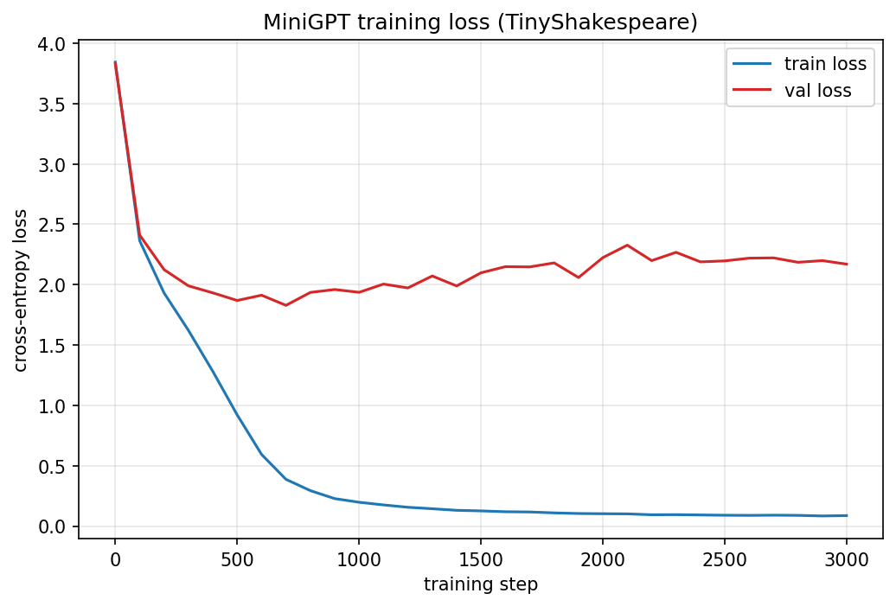

# MiniGPT — a GPT built from scratch in PyTorch

A small decoder-only Transformer implementing **every core mechanism by hand** — scaled
dot-product attention with causal masking, multi-head attention, residual connections,
weight tying and autoregressive sampling. Character-level, ~10.8M parameters, trained on
a **public-domain books corpus** (Shakespeare + 8 Gutenberg novels, ~5.6M characters).

**Why:** to understand GPTs by building one — every line in this repo is either fully
understood or removed.

## Quick start

```bash
pip install -r requirements.txt        # torch, matplotlib, rich
```

**Train** — every `.txt` file in `data/` is concatenated into one corpus (vocab size is
counted from it at startup). Interrupted? Re-run the same command with `--resume` to
continue from the last checkpoint (model, optimizer and loss history are restored):

```bash
python train.py --data data --max-iters 20000
```

**Generate** — an empty prompt starts from a newline character (nanoGPT convention).
The character-level tokenizer is stored inside the checkpoint, so decoding always works:

```bash
python generate.py --checkpoint checkpoints/model.pt --prompt "It was a bright" --max-new-tokens 500
```

**Chat** — a terminal chat REPL: type a message and the reply streams in one character
at a time. The model is a plain character-level LM, so it *continues* the conversation
text rather than following instructions. Commands: `/help`, `/clear`, `/exit`:

```bash
python chat.py
```

## Sample output

Real generation from the committed checkpoint, prompted with `"Hello! How are you today?"`:

```
Hello! How are you today?

Hello, nice to meet you.

Hello.
Helo.
Hi there! I am glad to see you.

How are you?
I am good. How about you?

How are you?
Not so good. I am a little tired.

How are you?
I am okay. A little sleepy.

What are you doing?
I am reading a book.
```



Note that training length, context window and model size are **settings, not fixed
properties** — iterations, `block_size`, batch size and the rest are CLI flags /
`GPTConfig` fields you can raise or lower freely (see [Configuration](#configuration)).
The sample above comes from a short run: longer training with a bigger context window
produces noticeably more coherent text.

## What's Implemented from First Principles

- **Attention** — scaled dot-product attention with causal masking (lower-triangular
  `-inf` mask so no token sees the future), projected by hand; **multi-head attention**
  with 6 heads attending in parallel 64-dim subspaces.
- **Residual blocks** — pre-norm residual connections (`x + sa(ln(x))`,
  `x + ffwd(ln(x))`) keep gradient variance ~1 through all 6 layers.
- **Autoregressive generation** — at each step the model predicts a distribution for the
  next character, samples with `torch.multinomial`, appends and repeats.
- **Training** — AdamW with linear LR warmup + cosine decay, gradient clipping,
  train/val evaluation.
- **Extras** — learned positional embeddings, weight tying (embedding ↔ output head),
  custom `normal_(0, 0.02)` init.

## Configuration

All hyperparameters live in `gpt/config.py` (`GPTConfig` dataclass — the single source
of truth, no hardcoded numbers in the code):

| Parameter | Default | Meaning |
|---|---|---|
| `vocab_size` | *no default* | set from the corpus — counted by the tokenizer first |
| `block_size` | 256 | context window (tokens) |
| `n_embd` | 384 | embedding width |
| `n_heads` | 6 | attention heads |
| `n_layers` | 6 | transformer blocks |
| `dropout` | 0.2 | dropout probability |
| `batch_size` | 32 | sequences per step |
| `max_iters` | 10000 | optimizer steps |
| `learning_rate` | 3e-4 | peak LR (warmup + cosine decay) |
| `eval_interval` / `eval_iters` | 500 / 200 | evaluation cadence / batches averaged |
| `warmup_iters` | 100 | linear LR warmup steps |
| `gradient_clip_norm` | 1.0 | max global grad norm |

Modern opt-in upgrades (classic design stays the default):

| Flag | What it does | Used in |
|---|---|---|
| `use_rmsnorm=True` | Replaces `LayerNorm` with **RMSNorm** (no mean subtraction) | LLaMA, Mistral, Gemma |
| `use_swiglu=True` | Replaces the ReLU feed-forward with a gated **SwiGLU** network (2/3 hidden scaling) | LLaMA, Mistral, PaLM, Gemma |

A **KV cache** was also implemented and verified (bit-identical sampling, measured
speedup), then removed to keep the codebase fully understood.

## Project Structure

```
my-gpt/
├── gpt/
│   ├── __init__.py      # public API of the package
│   ├── model.py         # Head, MultiHeadAttention, FeedForward, SwiGLU, RMSNorm, Block, GPT
│   ├── config.py        # GPTConfig dataclass holding every hyperparameter
│   ├── dataset.py       # corpus loading, CharTokenizer, train/val split, get_batch()
│   └── utils.py         # LR schedule, estimate_loss, checkpoints, loss curve, sampling
├── train.py             # training CLI: --data --checkpoint-dir --max-iters --device --resume
├── generate.py          # generation CLI: --checkpoint --max-new-tokens --prompt
├── chat.py              # terminal chat REPL: --checkpoint --max-new-tokens
├── data/                # training text files (public-domain corpus)
├── notebooks/gpt-v1.ipynb  # original prototype notebook, kept untouched
├── checkpoints/         # written by train.py: model.pt, loss_history.json, loss_curve.png, sample.txt
└── requirements.txt
```

## Roadmap

- [ ] KV cache for incremental decoding (implemented once, removed to keep the repo fully
      understood — re-add with measured speedup)
- [ ] Temperature / top-k sampling options
- [ ] Word-level tokenizer variant

## Notes

- The original prototype (`gpt-v1.ipynb`) is preserved untouched in `notebooks/`.
- Training data is public domain: TinyShakespeare (via karpathy/char-rnn) and Project
  Gutenberg novels (Alice in Wonderland, Dracula, Frankenstein, Moby Dick, Pride and
  Prejudice, The Adventures of Sherlock Holmes, The Time Machine, Treasure Island).
