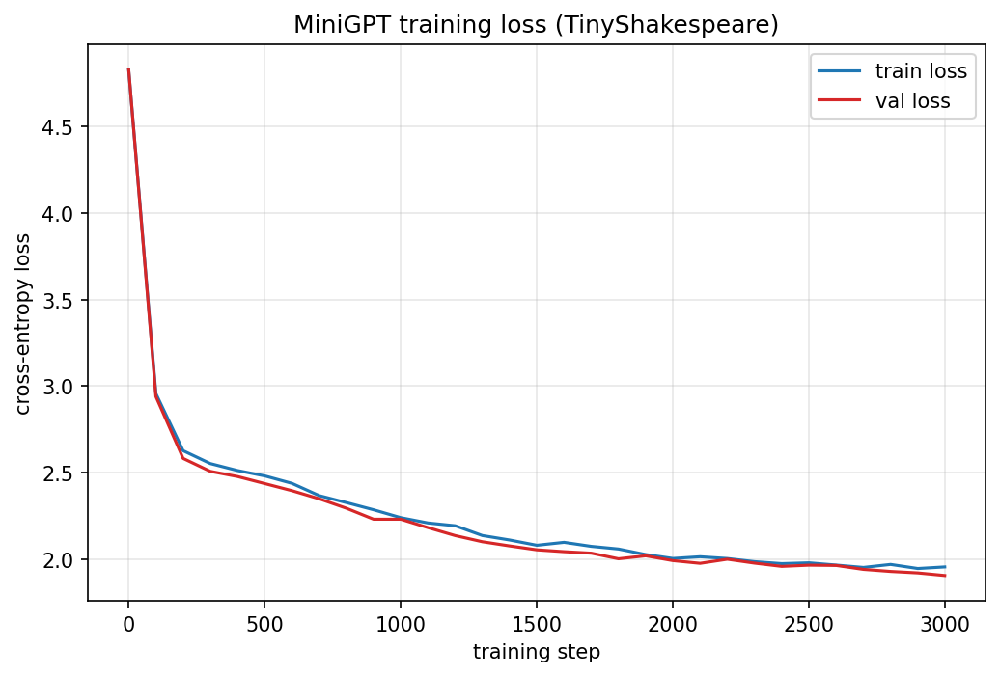

# MiniGPT — a GPT built from scratch in PyTorch

A small decoder-only Transformer implementing **every core mechanism by hand** — scaled
dot-product attention with causal masking, multi-head attention, residual connections,
weight tying and autoregressive sampling. Character-level, ~10.8M parameters, trained on
a **public-domain books corpus** (Shakespeare + 8 Gutenberg novels, ~5.6M characters).

**Why:** to understand GPTs by building one — every line in this repo is either fully
understood or removed.

## Results

Training recipe: 20,000 iterations, batch 32, AdamW with linear warmup + cosine decay
and gradient clipping:



<!-- SAMPLE:BEGIN -->
### Sample generation

_(sample from the full training run will be pasted here)_
<!-- SAMPLE:END -->

## Core Concepts Implemented from First Principles

- **Scaled dot-product attention with causal masking** — queries, keys and values are
  projected by hand; `q·kᵀ` products are scaled by `1/√head_size` so unit-variance inputs
  keep the softmax from saturating, and a lower-triangular mask (`-inf`) forbids every
  token from "seeing the future".
- **Multi-Head Attention** — 6 heads each attend in their own 64-dim subspace, giving the
  model several simultaneous "communication channels" per layer; head outputs are
  concatenated and projected back to the model width.
- **Residual connections & normalization** — pre-norm residual blocks (`x + sa(ln(x))`,
  `x + ffwd(ln(x))`) keep gradients flowing cleanly through all 6 layers, so variance
  stays ~1 across the whole stack.
- **Autoregressive text generation** — at each step the model predicts a distribution for
  the next character, samples from it with `torch.multinomial`, appends the character and
  repeats, conditioning on its own previous outputs.
- **Learning rate warmup + cosine decay** — the LR ramps linearly during the first 100
  steps, then follows a cosine down to 10% of peak; gradient norms are clipped to 1.0
  for stable long runs.
- **Extras** — learned positional embeddings, weight tying (embedding ↔ output head),
  custom `normal_(0, 0.02)` initialization, train/val loss evaluation.

## Modern Architecture Upgrades (opt-in)

Both upgrades live behind `GPTConfig` flags so the classic design stays the default.
Both upgrades live behind `GPTConfig` flags so the classic design stays the default.

| Flag | What it does | Used in |
|---|---|---|
| `use_rmsnorm=True` | Replaces `LayerNorm` with **RMSNorm** (no mean subtraction) | LLaMA, Mistral, Gemma |
| `use_swiglu=True` | Replaces the ReLU feed-forward with a gated **SwiGLU** network (2/3 hidden scaling) | LLaMA, Mistral, PaLM, Gemma |

A **KV cache** was also implemented and verified (bit-identical sampling, measured
speedup), then removed to keep the codebase fully understood.

## Setup

```bash
pip install -r requirements.txt          # torch, matplotlib
```

All 9 corpus files are already in `data/` (TinyShakespeare + 8 Project Gutenberg novels,
downloaded from Project Gutenberg / karpathy's char-rnn with license boilerplate removed).

## Train

```bash
python train.py --data data --max-iters 20000 --checkpoint-dir checkpoints
```

- `--data data` points at the folder: every `.txt` file in it is concatenated into one
  corpus (vocab size is counted from that corpus at startup).
- Writes `checkpoints/model.pt` + `checkpoints/loss_history.json` every evaluation and
  `checkpoints/loss_curve.png` + `checkpoints/sample.txt` at the end.
- Interrupted? Re-run the same command with `--resume` to continue from the last
  checkpoint (model, optimizer and loss history are all restored).
- `run_training.ps1` runs the same thing detached, so closing the terminal doesn't kill it.

## Generate

```bash
python generate.py --checkpoint checkpoints/model.pt --prompt "It was a bright" --max-new-tokens 500
```

An empty prompt starts generation from a single newline character (nanoGPT convention).
The character-level tokenizer is stored inside the checkpoint, so decoding always works.

## Configuration

All hyperparameters live in `gpt/config.py` (`GPTConfig` dataclass — the single source
of truth, no hardcoded numbers in the code):

| Parameter | Default | Meaning |
|---|---|---|
| `vocab_size` | *no default* | set from the corpus — counted by the tokenizer first |
| `block_size` | 256 | context window (tokens) |
| `n_embd` | 384 | embedding width |
| `n_heads` | 6 | attention heads |
| `n_layers` | 6 | transformer blocks |
| `dropout` | 0.2 | dropout probability |
| `batch_size` | 32 | sequences per step |
| `max_iters` | 10000 | optimizer steps |
| `learning_rate` | 3e-4 | peak LR (warmup + cosine decay) |
| `eval_interval` / `eval_iters` | 500 / 200 | evaluation cadence / batches averaged |
| `warmup_iters` | 100 | linear LR warmup steps |
| `gradient_clip_norm` | 1.0 | max global grad norm |

## Project Structure

```
my-gpt/
├── gpt/
│   ├── __init__.py      # public API of the package
│   ├── model.py         # Head, MultiHeadAttention, FeedForward, SwiGLU, RMSNorm, Block, GPT
│   ├── config.py        # GPTConfig dataclass holding every hyperparameter
│   ├── dataset.py       # corpus loading, CharTokenizer, train/val split, get_batch()
│   └── utils.py         # LR schedule, estimate_loss, checkpoints, loss curve, sampling
├── train.py             # training CLI: --data --checkpoint-dir --max-iters --device --resume
├── generate.py          # generation CLI: --checkpoint --max-new-tokens --prompt
├── run_training.ps1     # detached training driver (Windows)

├── data/                # training text files (public-domain corpus)
├── notebooks/gpt-v1.ipynb  # original prototype notebook, kept untouched
├── checkpoints/         # written by train.py: model.pt, loss_history.json, loss_curve.png, sample.txt
└── requirements.txt
```

## Roadmap

- [ ] KV cache for incremental decoding (implemented once, removed to keep the repo fully
      understood — re-add with measured speedup)
- [ ] Temperature / top-k sampling options
- [ ] Word-level tokenizer variant

## Notes

- The original prototype (`gpt-v1.ipynb`) is preserved untouched in `notebooks/`.
- Training data is public domain: TinyShakespeare (via karpathy/char-rnn) and Project
  Gutenberg novels (Alice in Wonderland, Dracula, Frankenstein, Moby Dick, Pride and
  Prejudice, The Adventures of Sherlock Holmes, The Time Machine, Treasure Island).
